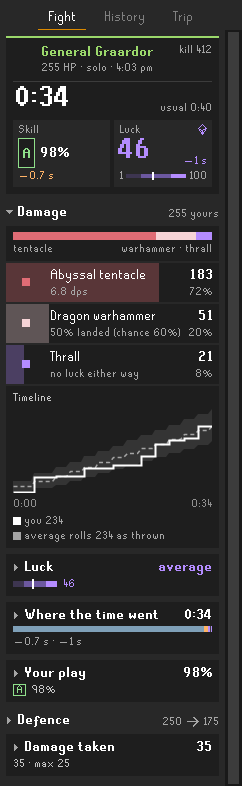
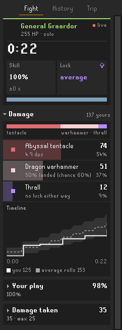
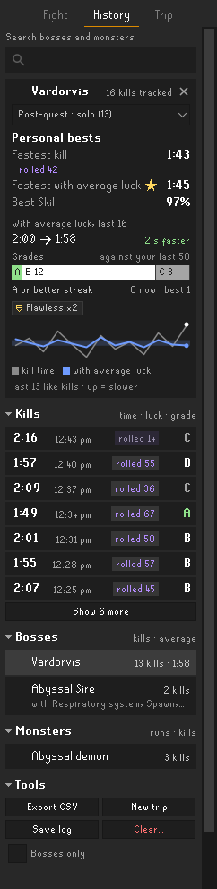
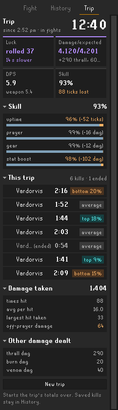
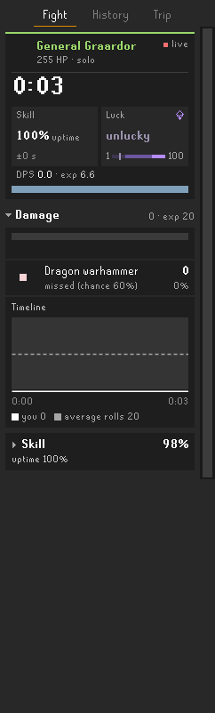
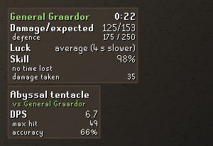
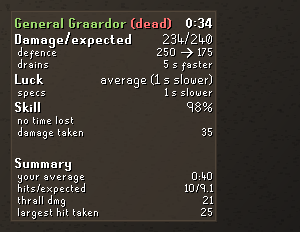
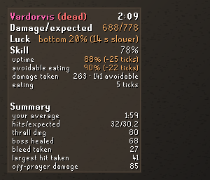
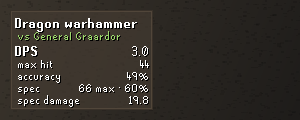

# Luck vs Skill

A RuneLite plugin for bossing. After every kill it tells you how much of your time was luck and how much was you, for any boss, and grades your play against your own kills. There's no account to make, and nothing about you is uploaded; in a RuneLite party, only your own numbers go to its members (see [What it sends](#what-it-sends)).

It works out what each of your attacks should have done, from your gear, levels, boosts and prayers against the boss's defence, and compares that with what you actually hit. The gap between your kill and a perfect one splits into two parts: **Luck** (the dice) and **Skill**, or Execution (the time you weren't attacking, or were attacking without the right setup).

## What it shows

### The kill card
The side panel's Fight tab opens on a card with three numbers: your **Time**, your **Skill** and your **Luck**. Everything else folds below it, one click away.

<table>
<tr>
<td></td>
<td></td>
</tr>
<tr><td>After the kill</td><td>During the fight</td></tr>
</table>

- **Time:** the kill's clock, and your usual time at this boss (the median of your last kills like this one). A new best gets a gold **PB**.
- **Skill:** how close you came to a perfect fight (always attacking, with your best gear on hand, the right prayer and your boosts), and the seconds the rest cost you. The letter is your **grade**:
  - it's against your own last 50 kills at this boss, scored the same way: **S** is your top 5%, **A** the next 25%, **B** the middle 60%, **C** your bottom 10%. Until you have 10 kills it uses fixed bands (S from 99.5%, A from 97.5%, B from 90%);
  - it comes from your play only, never from luck. Hover it to see what the next grade would have taken.
- **Luck:** "rolled 46 of 100": where your damage falls among all the ways the same attacks could have rolled, from 1 (the unluckiest) to 100, and the seconds it saved or cost. It's coloured in three strengths of violet, never in Skill's colours: luck isn't skill.
- **Badges** show on the card when a kill earns one:
  - **100th kill** (and every hundredth, by the game's kill count);
  - **Flawless:** no avoidable damage taken (only at bosses with attack rules, so far Vardorvis);
  - **Clean run:** not one idle tick, and your prayer, gear and boosts as good as they could be;
  - **3 A's in a row** (and longer streaks): grade A or better on your last three kills here.

During the fight the card shows the clock, the share of the fight you've spent attacking with a strip of your idle moments so far, and your luck so far. Every number explains itself in its tooltip.

**Celebrations** (on by default) is the card and its kill-end moment, when the roll lands and the grade shows. Turn it off under the plugin's Side panel settings for the plain Fight tab: the boss's title and four tiles, every section as you left it.

### Below the card
- **Damage:** your damage by weapon, spell and special, each with its DPS against expected; your thrall, burn and the rest apart; at a boss with adds, the boss, its adds or both. A timeline of your damage against average rolls.
- **Luck, Where the time went, Your play:** the luck curve; the kill's time split into best play, the ticks you lost and what luck saved or cost; uptime, prayer, gear and stat boost.
- **Defence:** when your special attacks (or your party's) lower the boss's Defence, the Defence left, each special against its chance, and what the drain was worth. A missed special counts as bad luck.
- **Damage taken,** after the fight by kind. At a boss with attack rules (Vardorvis so far), the food you ate because of damage you could have avoided counts against your play, and damage taken says how much was avoidable.
- **Your party:** in a RuneLite party, the members' damage, DPS and share at the top of the Fight tab, and after a room their luck and play, from members who run Luck vs Skill too; click one to see their Fight tab. Members who don't run it are listed by name and picture; with just one of them, their damage is shown as about what the boss took that you didn't deal. Discord pictures show when RuneLite's Discord plugin provides them.

### History and Trip
**History** shows your progress at each boss: your personal bests (fastest, fastest with luck taken out, best play), how your grades spread, your streaks and badges, and your kill time against your time with luck taken out, kill by kill. Then every saved kill with its time, roll and grade, your bosses and your monster runs, and Tools (CSV export, a new trip, saving a debug log). **Trip** sums the session's kills.

<table>
<tr>
<td></td>
<td></td>
</tr>
<tr><td>History</td><td>Trip</td></tr>
</table>

The Fight tab through a kill, updating every 5 ticks, then the card once the boss dies (the same simulated General Graardor kill, at 7.5× speed):



### The fight overlay
Live during the fight, the breakdown after the kill: damage against expected, Luck, Execution (uptime, prayer, gear and stat boost), and your usual time.

<table>
<tr>
<td></td>
<td></td>
</tr>
<tr>
<td>Mid-fight, with the DPS overlay under it</td>
<td>After the kill: the drain's worth, and your usual time</td>
</tr>
</table>

After a kill at a boss with attack rules, Execution gains an **avoidable eating** line and damage taken says how much was avoidable:



### The DPS overlay
Your current weapon's DPS, max hit and accuracy against the monster it names, and its special attack's. It can also stay up outside fights ("Always show DPS overlay"), against the last monster you fought; after a minute without an attack it shrinks to what needs no monster: the max hit and the special's.



### What it never shows during a fight
Nothing about the boss's attacks or when to do anything, and no comparison with your own average while you fight: only your own output, as Jagex's rules for third-party clients require. Your usual time, your grade and anything judged from the boss's behaviour (Cerberus's stall, for one) come once the fight is over.

### Also
- Counts your thrall's hits apart from your own, and burn, poison, venom, bleed, recoil, vengeance and the boss healing apart from your weapon.
- Bosses with parts, phases or adds are one kill each; weak adds are swatted in passing without opening a fight. A run of monsters of one kind is one room, with a lighter view.
- Downtime the boss forces on you (a stun, a dive, a burrow) and strategies the guides teach (holding Cerberus above 400) aren't held against your uptime.
- Scales bosses for party size and raid level in the Chambers of Xeric and the Tombs of Amascut.
- Exports fights to CSV.

All the pictures here are drawn by the plugin's own code (see Developing) from made-up example fights, over a plain dark backdrop: the overlays are see-through in game. The panel's boss icons are the game's own and don't show in these pictures.

## What it sends
One download, your own numbers to your RuneLite party if you're in one, and nothing uploaded anywhere else.
- **Monster stats:** when the plugin starts and its copy is missing or more than 7 days old, it downloads `monsters.json`, the monster data of the [OSRS Wiki's DPS calculator](https://github.com/weirdgloop/osrs-dps-calc), from GitHub (`raw.githubusercontent.com`). It uses RuneLite's own web client and identifies itself only as `RuneLite plugin luck-vs-skill`. Like any download, GitHub sees your IP address; nothing about your account goes with it. The copy is kept in your data folder; if the download fails, the plugin uses the copy it has.
- **Your RuneLite party** (on by default): only while you're in a party, and only through RuneLite's own party service to that party's members. Turn off **Share with my RuneLite party** (Side panel settings) and nothing is sent; others' numbers still show.
  - **During a boss fight,** at most every 5 ticks, and once as the room ends: the room's name and start, the raid's name if you're in one; your weapon damage and its expected damage, other damage of yours (thrall, burn and the like), attacks, combat ticks and the clock; Luck (the roll and its seconds), Execution, uptime and idle ticks, what your stat boost, gear and prayer cost; the damage and hits you took; and up to 8 attack rows, each a weapon or spell by its game id with its attacks, landings, damage and expected damage.
  - **As a room ends,** your Fight tab for it, so members can click into your fight: the same figures as the card and sections show them, the damage by source and the timeline.
  - Never your name (members see it from RuneLite's party, as in any party plugin), your armour, location, stats, account or history.
- **Everything else stays on your computer,** in `~/.runelite/plugin-data/luck-vs-skill/`:
  - `history.json`, your saved fights, and `history-last-good.json`, a copy kept from the last time it loaded;
  - `records.json`, your bests, grades and badges at each boss, and `records-last-good.json`;
  - each of those is written as a `.tmp` beside it first, so a crash can't leave it half-written; a file that won't read is kept as `history-unreadable-<time>.json` or `records-unreadable-<time>.json` rather than written over;
  - `monsters.json`, the downloaded monster stats;
  - `install-id`, a random id for this install, not tied to your account and not sent anywhere;
  - debug logs (`pvm-debug-*.log`) only while **Debug logging** is on or when you press **Save debug log**, `calibration-*.txt` only when you press **Calibration report** (shown with Debug logging on), and CSV exports (`pvm-*.csv`) only when you export.
  - Boss icons come from the game client itself.

## Known limits
- **Checked against real kills** (read in debug logs, each kill's damage reconciled with the boss's hitpoints): Vardorvis, the Abyssal Sire, the Leviathan, Araxxor, Vorkath, Cerberus, Venenatis, Yama (duo), Hespori, the Royal Titans, the Great Olm (Chambers of Xeric, solo) and the Tombs of Amascut's bosses. Every other boss comes from the OSRS Wiki and the DPS calculator, not yet from logs.
<!-- T-197: the Orchestrator finalises this list from the plan's "Checked bosses" table when the release-candidate run passes. -->
- **In the Tombs with a party,** a boss's hitpoints are read from its health bar; a monster without one is counted at its one-player hitpoints.
- **Not modelled:**
  - the Awakened Desert Treasure II mechanics beyond their stats (the Awakened Leviathan's stun and pathfinder, for example);
  - Umbra's and Glacies' Vows (Leagues only) and Defence-lowering spells;
  - burn from burning claws in *expected* damage (it's counted once it lands);
  - the Theatre of Blood hasn't been checked; shields and poise there (Verzik's first phase) may count as damage.
- **Guessed, where no source says:** what counts as behind the Leviathan for a back shot, and how its 33% reduction rounds; how fast drained Defence comes back (mostly from a wiki user's measurements), and that it starts coming back at the first drain.
- **Thralls:** a zombie thrall's timing hasn't been confirmed in a log, and in a group where teammates summon at the same moment, a teammate's thrall could be taken for yours.
- **Rules about the boss's attacks** (for avoidable damage, avoidable eating and Flawless) exist for Vardorvis only.
- **Grades** need a few kills at a boss to mean much: the first 10 use fixed bands.

## Where it came from
Luck vs Skill began as a fork of Arodab's [PvM Performance Tracker](https://github.com/Arodab/pvm-performance-tracker), and builds on his combat model. It fixed the build against current RuneLite and counts thrall hits apart from your own ([Arodab's issue #1](https://github.com/Arodab/pvm-performance-tracker/issues/1)).

It is its own plugin, with its own settings and its own folder: nothing it does reads, moves or changes PvM Performance Tracker's settings or fight history, so the two can be installed side by side. Fight history, exports and logs live in `~/.runelite/plugin-data/luck-vs-skill/`.

## Changes
See [`CHANGELOG.md`](CHANGELOG.md).

## Developing
These are the steps that work on Windows. Run them in PowerShell, from the repo folder.

1. **Install JDK 11** (once):
   ```powershell
   winget install EclipseAdoptium.Temurin.11.JDK
   ```
2. **Point `JAVA_HOME` at it** (in every new PowerShell window):
   ```powershell
   $env:JAVA_HOME = (Get-ChildItem "C:\Program Files\Eclipse Adoptium" -Directory -Filter "jdk-11*" | Select-Object -First 1).FullName
   ```
   Or paste the exact folder, e.g. `$env:JAVA_HOME = "C:\Program Files\Eclipse Adoptium\jdk-11.0.x-hotspot"`.
3. **Start the dev client** with the plugin loaded (developer mode):
   ```powershell
   .\gradlew.bat run
   ```
4. **Log in:** in the client's sidebar, open the Jagex account panel → **Add Jagex Account** → sign in → pick your character → **Play Now**. If an old `.runelite\credentials.properties` exists, delete it first.
5. **Capture a debug log:** after a fight, press **Save debug log** on the side panel's Fight tab (or **Save log** under History → Tools). It writes the last few thousand lines. For a whole session, turn on **Debug logging** in the plugin's settings instead.
6. **Find the files** in `%USERPROFILE%\.runelite\plugin-data\luck-vs-skill\`: `pvm-debug-recent-*.log` (the button), `pvm-debug-*.log` (the setting), `history.json` and CSV exports.

**Tests:** `.\gradlew.bat test` on Windows, or `./gradlew test` on Linux and macOS (JDK 11 or newer). CI runs them on every push and pull request.

**History repair (T-138, one-off):** with RuneLite closed, `.\gradlew.bat historyRepair` lists the Yama kills saved split before T-136 and changes nothing; add `-Papply` to stitch them, after a backup beside `history.json` (`-ParaxxorSolo` also marks the Araxxor kills saved before T-106 solo).

**Panel timing:** `./gradlew run -PrepaintTiming` adds the side panel's whole repaint pass to the debug log's `PERF` lines.

**README pictures:** everything in `docs/images/` comes from one generator, `ReadmePictures` (test code), which draws with the plugin's own overlay and panel code. Run it again whenever the look changes; the same code gives the same files.
```
./gradlew shadowJar
java -Djava.awt.headless=true -cp build/libs/pvm-logs-unspecified-all.jar com.pvmlogs.ReadmePictures
```
On Windows (PowerShell needs the quotes):
```powershell
.\gradlew.bat shadowJar
java "-Djava.awt.headless=true" -cp build\libs\pvm-logs-unspecified-all.jar com.pvmlogs.ReadmePictures
```

`CLAUDE.md` covers how Claude sessions work on this repo. `docs/HANDOFF.md` records what is known about thrall damage and other damage that isn't the player's attack.

## Credits
- Arodab, for PvM Performance Tracker, which Luck vs Skill began as a fork of;
- Special thanks to Kinomoto and zLost for a ton of valuable feedback and ideas for the plugin;
- Portions of the combat math were ported from the LlemonDuck dps-calculator (BSD-2);
- Monster stats come from the [OSRS Wiki](https://oldschool.runescape.wiki)'s [DPS calculator](https://github.com/weirdgloop/osrs-dps-calc) and its contributors (downloaded at runtime, never bundled), and game facts from the Wiki;
- Chambers of Xeric scaling math taken from **GearScape**.
- Defence drain tracking follows RuneLite's Special Attack Counter and was checked against Better Party Defence (with OSParty) and Party Defence Tracker, all BSD-2; notices in `THIRD-PARTY.md`.
