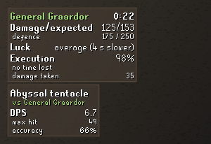
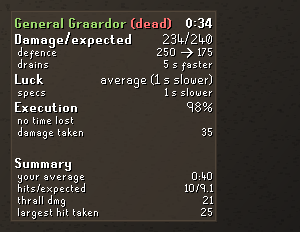
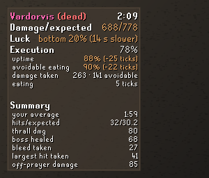
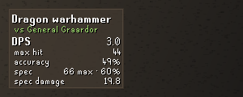
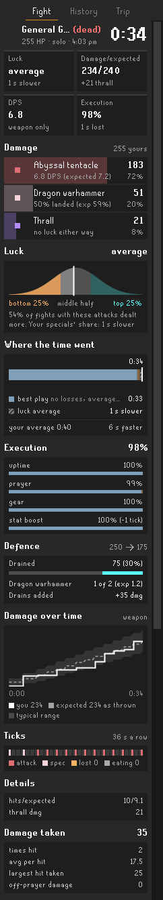
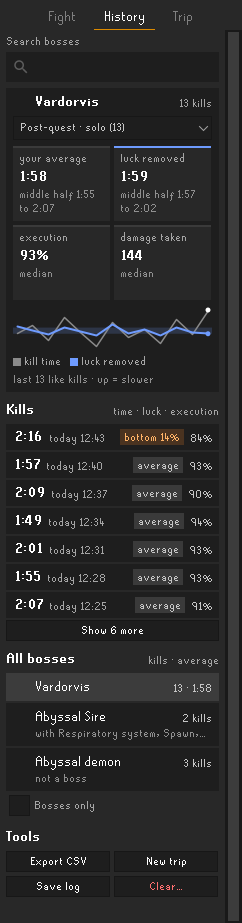
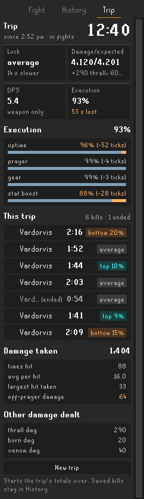
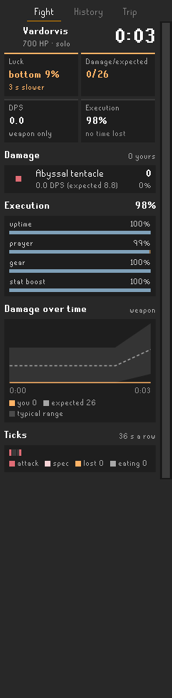

# Luck vs Skill

A RuneLite plugin for bossing. After every kill it tells you how much of your time was luck and how much was you, for any boss. There's no account to make, and nothing about you is uploaded (see [What it sends](#what-it-sends)).

It works out what each of your attacks should have done, from your gear, levels, boosts and prayers against the boss's defence, and compares that with what you actually hit. The gap between your kill and a perfect one splits into two parts: **Luck** (the dice) and **Execution** (the time you weren't attacking, or were attacking without the right setup).

## What it shows

### Luck and Execution
- **Luck** says how lucky the kill was: where your damage falls among all the ways the same attacks could have rolled (bottom 20%, the middle half, top 15%), and what that cost or saved in seconds.
- **Execution** says how much of the fight you spent attacking, and with the right setup: uptime, with the ticks you lost, and prayer, gear and stat boost, with the expected damage each cost.
- **Defence drain:** when your special attacks (or your party's) lower the boss's Defence, it tracks the Defence left, counts a missed special as bad luck, and says how much time the drain saved.
- **After a kill at a boss with attack rules** (Vardorvis so far), it also counts the food you ate because of damage you could have avoided, and how much of the damage you took was avoidable.

### The fight overlay
Live during the fight, the full breakdown after the kill.

<table>
<tr>
<td></td>
<td></td>
</tr>
<tr>
<td>Mid-fight, with the DPS overlay under it</td>
<td>After the kill: the drain's worth, and your usual time</td>
</tr>
</table>

After a kill at a boss with attack rules, Execution gains an **avoidable eating** line and damage taken says how much was avoidable:



### The DPS overlay
Your current weapon's DPS, max hit and accuracy against the monster it names, and its special attack's. It can also stay up outside fights ("Always show DPS overlay"), against the last monster you fought; after a minute without an attack it shrinks to what needs no monster: the max hit and the special's.



### The side panel
- **Fight:** where the time went, Luck, the Defence your specials took, Execution, damage by weapon and source, damage over time, a tick strip, and damage taken.
- **History:** your saved kills, and your usual time and execution at each boss.
- **Trip:** the session's kills together.

<table>
<tr>
<td></td>
<td></td>
<td></td>
</tr>
<tr><td>Fight</td><td>History</td><td>Trip</td></tr>
</table>

The Fight tab during a kill, updating every 5 ticks, then the top of the view once the boss dies (a simulated two-minute Vardorvis kill at 7.5× speed):



### What it never shows during a fight
Nothing about the boss's attacks, and no comparison with your own average while you fight: only your own output, as Jagex's rules for third-party clients require. Your average appears once the fight is over.

### Also
- Counts your thrall's hits apart from your own, and burn, poison, venom, bleed and the boss healing apart from your weapon.
- Scales boss defence for party size and raid level in the Chambers of Xeric and Tombs of Amascut.
- Exports fights to CSV.

All the pictures here are drawn by the plugin's own code (see Developing) from made-up example fights, over a plain dark backdrop: the overlays are see-through in game. The panel's boss icons are the game's own and don't show in these pictures.

## What it sends
One download, and nothing uploaded.
- **Monster stats:** when the plugin starts and its copy is missing or more than 7 days old, it downloads `monsters.json`, the monster data of the [OSRS Wiki's DPS calculator](https://github.com/weirdgloop/osrs-dps-calc), from GitHub (`raw.githubusercontent.com`). It uses RuneLite's own web client and identifies itself only as `RuneLite plugin luck-vs-skill`. Like any download, GitHub sees your IP address; nothing about your account goes with it. The copy is kept in your data folder; if the download fails, the plugin uses the copy it has.
- **Everything else stays on your computer:** your fight history (`history.json`), CSV exports, debug logs and a random id for this install (`install-id`, not tied to your account and not sent anywhere), in `~/.runelite/plugin-data/luck-vs-skill/`. Boss icons come from the game client itself.

## Known limits
- **Checked against real kills:** Vardorvis, the Abyssal Sire and the Leviathan, and Defence drain once (a special at the Sire). Every other boss, the raids, and the other drain rules come from the OSRS Wiki and the DPS calculator, not yet from logs.
- **Not modelled:**
  - the Awakened Desert Treasure II mechanics beyond their stats (the Awakened Leviathan's stun and pathfinder, for example);
  - Umbra's and Glacies' Vows (Leagues only) and Defence-lowering spells;
  - burn from burning claws in *expected* damage (it's counted once it lands);
  - the coloured hitsplats some bosses use for shields or poise (Verzik's first phase, Kephri, the Wardens), which count as damage.
- **Guessed, where no source says:** what counts as behind the Leviathan for a back shot, and how its 33% reduction rounds; how fast drained Defence comes back (mostly from a wiki user's measurements), and that it starts coming back at the first drain.
- **Thralls:** a zombie thrall's timing hasn't been confirmed in a log, and in a group where teammates summon at the same moment, a teammate's thrall could be taken for yours.
- **Rules about the boss's attacks** (for avoidable damage and eating) exist for Vardorvis only.

## Where it came from
Luck vs Skill began as a fork of Arodab's [PvM Performance Tracker](https://github.com/Arodab/pvm-performance-tracker), and builds on his combat model. It fixed the build against current RuneLite and counts thrall hits apart from your own ([Arodab's issue #1](https://github.com/Arodab/pvm-performance-tracker/issues/1)).

It is its own plugin, with its own settings and its own folder: nothing it does reads, moves or changes PvM Performance Tracker's settings or fight history, so the two can be installed side by side. Fight history, exports and logs live in `~/.runelite/plugin-data/luck-vs-skill/`.

## Changes
See [`CHANGELOG.md`](CHANGELOG.md).

## Developing
These are the steps that work on Windows. Run them in PowerShell, from the repo folder.

1. **Install JDK 11** (once):
   ```powershell
   winget install EclipseAdoptium.Temurin.11.JDK
   ```
2. **Point `JAVA_HOME` at it** (in every new PowerShell window):
   ```powershell
   $env:JAVA_HOME = (Get-ChildItem "C:\Program Files\Eclipse Adoptium" -Directory -Filter "jdk-11*" | Select-Object -First 1).FullName
   ```
   Or paste the exact folder, e.g. `$env:JAVA_HOME = "C:\Program Files\Eclipse Adoptium\jdk-11.0.x-hotspot"`.
3. **Start the dev client** with the plugin loaded (developer mode):
   ```powershell
   .\gradlew.bat run
   ```
4. **Log in:** in the client's sidebar, open the Jagex account panel → **Add Jagex Account** → sign in → pick your character → **Play Now**. If an old `.runelite\credentials.properties` exists, delete it first.
5. **Capture a debug log:** after a fight, press **Save debug log** on the side panel's Fight tab (or **Save log** under History → Tools). It writes the last few thousand lines. For a whole session, turn on **Debug logging** in the plugin's settings instead.
6. **Find the files** in `%USERPROFILE%\.runelite\plugin-data\luck-vs-skill\`: `pvm-debug-recent-*.log` (the button), `pvm-debug-*.log` (the setting), `history.json` and CSV exports.

**Tests:** `.\gradlew.bat test` on Windows, or `./gradlew test` on Linux and macOS (JDK 11 or newer). CI runs them on every push and pull request.

**History repair (T-138, one-off):** with RuneLite closed, `.\gradlew.bat historyRepair` lists the Yama kills saved split before T-136 and changes nothing; add `-Papply` to stitch them, after a backup beside `history.json` (`-ParaxxorSolo` also marks the Araxxor kills saved before T-106 solo).

**README pictures:** everything in `docs/images/` comes from one generator, `ReadmePictures` (test code), which draws with the plugin's own overlay and panel code. Run it again whenever the look changes; the same code gives the same files.
```
./gradlew shadowJar
java -Djava.awt.headless=true -cp build/libs/pvm-logs-unspecified-all.jar com.pvmlogs.ReadmePictures
```
On Windows (PowerShell needs the quotes):
```powershell
.\gradlew.bat shadowJar
java "-Djava.awt.headless=true" -cp build\libs\pvm-logs-unspecified-all.jar com.pvmlogs.ReadmePictures
```

`CLAUDE.md` covers how Claude sessions work on this repo. `docs/HANDOFF.md` records what is known about thrall damage and other damage that isn't the player's attack.

## Credits
- Arodab, for PvM Performance Tracker, which Luck vs Skill began as a fork of;
- Special thanks to Kinomoto and zLost for a ton of valuable feedback and ideas for the plugin;
- Portions of the combat math were ported from the LlemonDuck dps-calculator (BSD-2);
- Monster stats come from the [OSRS Wiki](https://oldschool.runescape.wiki)'s [DPS calculator](https://github.com/weirdgloop/osrs-dps-calc) and its contributors (downloaded at runtime, never bundled), and game facts from the Wiki;
- Chambers of Xeric scaling math taken from **GearScape**.
- Defence drain tracking follows RuneLite's Special Attack Counter and was checked against Better Party Defence (with OSParty) and Party Defence Tracker, all BSD-2; notices in `THIRD-PARTY.md`.
